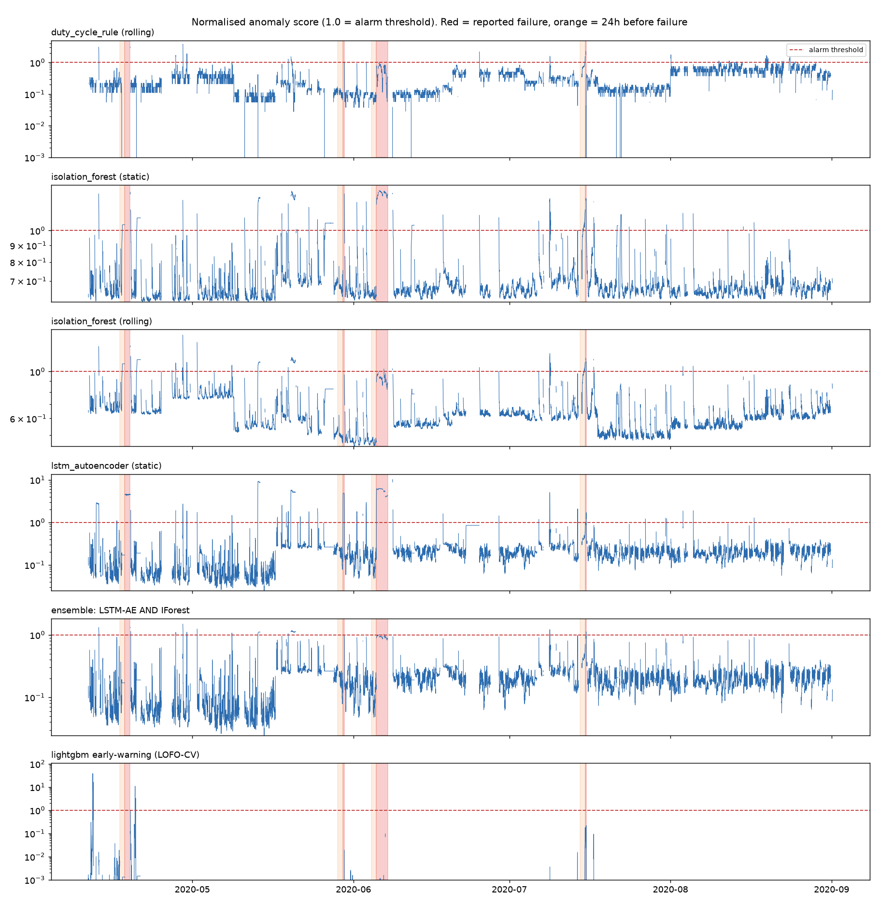
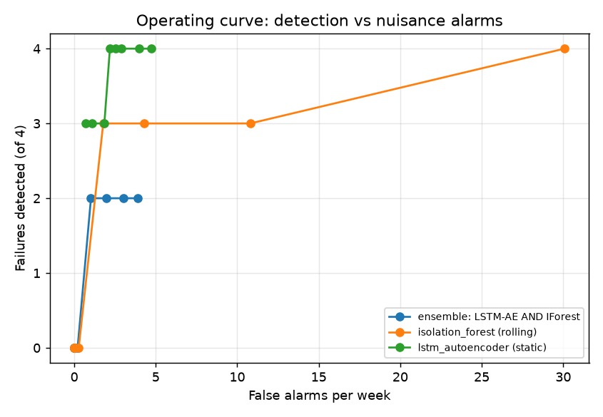

# Compressor Fault Detection for Mining Fleet Equipment

[](https://github.com/harshit-3/compressor-fault-detection/actions)

An end-to-end anomaly detection system that catches **air-leak failures in industrial compressors**,
evaluated on **7 months of real sensor telemetry (1.5M readings)** with no failure labels. It ships as a
REST API, a maintenance-planner dashboard, and a Dockerised service with CI.

> **Why compressors?** Haul trucks, drills and processing plants rely on compressed-air systems for
> braking, suspension and pneumatics. An undetected air leak means unplanned downtime, which in mining
> costs tens of thousands of dollars per hour per asset. The data here (MetroPT-3) comes from a real
> air production unit and has the same sensor profile (pressures, motor current, oil temperature, valve
> states) as mobile mining-equipment compressors.



## Results

All detectors are evaluated on **four real air-leak failures they never saw during training**. Thresholds
are calibrated on held-out healthy data only, so no failure labels touch model selection.

| Model | Failures detected | Chance level* | False alarms / week |
|---|---|---|---|
| Domain rule (compressor duty cycle > 30%) | 2 / 4 | 0.9 / 4 | 0.96 |
| Isolation Forest (83 engineered features) | 3 / 4 | 2.3 / 4 | 3.49 |
| Isolation Forest + 14-day rolling retraining | 3 / 4 | 1.5 / 4 | **1.78** (−49%) |
| **LSTM autoencoder (deployed)** | **4 / 4** | 1.9 / 4 | 2.53 |
| Ensemble (LSTM-AE AND IForest must agree) | 2 / 4 | 1.0 / 4 | 1.03 |
| LightGBM supervised (leave-one-failure-out CV) | 0 / 4 | – | 0.64 |

\* *Chance level* is the expected number of failures a random alarm generator would "detect" at the same
false-alarm rate. Accuracy is a misleading metric with 4 events, so this is the honest baseline. The
probability of the LSTM-AE's 4/4 arising by chance is about 5%.

**Operating point.** The planner chooses the trade-off. At 1.25× the calibrated threshold the LSTM-AE
detects **4/4 failures at 2.2 false alarms per week**; at 3× it detects **3/4 at 0.7 per week**.



**Inference latency:** 15 ms model / 24 ms end-to-end per request (p50, single CPU thread).

### What I learned (the interesting part)

1. **Supervised learning failed, and that's the finding.** With 4 failures, a LightGBM classifier
   evaluated with leave-one-failure-out CV detected 0/4. It memorises the 3 training events instead of
   learning what a leak looks like. Unsupervised models trained on *normal* behaviour don't need failure
   examples, which is why they're the industry default for rare-failure assets.
2. **The physics shows up in the data.** During leaks the compressor's duty cycle jumps from **10% to 66%**
   and oil temperature rises **62°C → 76°C** as it fights to hold reservoir pressure. The model's
   per-sensor attribution points to `DV_pressure` (air-dryer discharge) on leak windows, which a
   maintenance engineer can act on.
3. **Cold starts were the #1 source of false alarms.** Masking the first 30 minutes after every
   logging gap (train parked → restart) removed a large class of spurious alarms.
4. **Seasonal drift is real.** Models trained in Feb–Mar see a level shift in late May as ambient
   temperatures rise. Rolling 14-day retraining cut Isolation Forest false alarms by 49%, but it hurt the
   LSTM-AE (missed failure #2, detected #3 34 h late). The likely cause is that its 60-day training
   window absorbed abnormal pre-failure behaviour as "normal". Retraining policy needs per-model
   validation, not a blanket rule.
5. **Detection, not prophecy.** Alarms fire 0.3–1.4 h after the reported failure start. These are
   leaks caught early in their progression, not days-ahead forecasts. The 4-event dataset can't
   honestly support claims of multi-day prediction.

## Architecture

```
 sensors (1 Hz) ─▶ 1-min resample ─▶ warm-up mask ─┬─▶ LSTM autoencoder (60-min windows) ─┐
                                                   └─▶ 83 rolling/physics features ─▶ IForest │
                                                                                            ▼
            planner dashboard ◀── alarms (30-min median, 15-min persistence, 6 h cooldown) ◀─ score
                                                                                            ▲
                                    FastAPI  POST /score ── per-sensor error attribution ───┘
```

| Component | Tech |
|---|---|
| Feature engineering | pandas: rolling stats over 15/60/240 min, duty cycle, load-switching rate, idle pressure decay |
| Models | PyTorch LSTM autoencoder (GPU training), scikit-learn Isolation Forest, LightGBM |
| Experiment tracking | MLflow (SQLite backend), every run logged with params and event metrics |
| Serving | FastAPI + Pydantic validation, CPU inference, weights-only checkpoint (no pickle) |
| Dashboard | Streamlit + Plotly: alarm replay with live threshold tuning, window scoring |
| Ops | Docker (non-root, healthcheck), GitHub Actions (lint → test → image build → API smoke test) |

## Quick start

```bash
pip install -r requirements-train.txt
python scripts/prepare_data.py          # downloads MetroPT-3 from UCI, builds 1-min dataset
PYTHONPATH=src python -m pdm.train      # trains + evaluates all models (a few minutes on an RTX 4070)
pytest                                  # 13 tests
streamlit run dashboard/app.py          # dashboard on :8501
PYTHONPATH=src uvicorn pdm.api:app      # API on :8000, docs at /docs
```

The trained model and replay data are committed, so the API and dashboard run without retraining.

**Docker:**

```bash
docker build -t compressor-pdm .
docker run -p 8000:8000 compressor-pdm
```

**Example request:**

```bash
curl -X POST localhost:8000/score -H "Content-Type: application/json" -d '{
  "asset_id": "HT-042",
  "readings": [{"TP2": 8.1, "TP3": 8.3, "H1": 8.2, "DV_pressure": 0.1,
                "Reservoirs": 8.3, "Oil_temperature": 71.2, "Motor_current": 5.4}, ... 60 total]
}'
# → {"score_ratio": 6.27, "anomalous": true, "top_sensor": "DV_pressure", "latency_ms": 15.1, ...}
```

## Project layout

```
src/pdm/
  data.py       load, resample, official failure windows
  features.py   rolling + physics-informed features
  models.py     duty-cycle rule, Isolation Forest, LSTM autoencoder, LightGBM
  alarms.py     score → alarm logic, event-level evaluation, chance baseline
  train.py      full experiment: static vs rolling retraining, ensemble, LOFO-CV, plots
  serving.py    production scorer (weights-only checkpoint)
  api.py        FastAPI service
dashboard/app.py  Streamlit planner dashboard
tests/            API contract + alarm logic tests on real data windows
```

## Data

MetroPT-3, UCI Machine Learning Repository (CC BY 4.0). Veloso et al., *The MetroPT dataset for
predictive maintenance*, Scientific Data 9, 764 (2022). Failure windows come from the operator's
maintenance reports.
